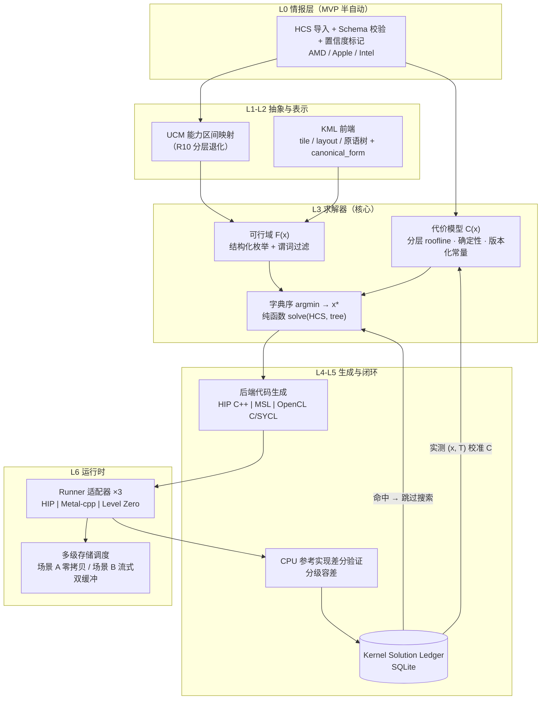

# UNIKERN MVP — 技术设计

Feature Name: unikern-mvp
Updated: 2026-10-26

## Description

三厂商 GPU 内核统一抽象与最优求解平台的第一阶段实现。KML 前端以 tile 原语树声明算子；
求解器以多面体约束构建可行域、以确定性解析代价模型为唯一仲裁、按 ( C(x), canonical_form(x) ) 字典序
输出唯一解 x\*；代码生成器从 KML 独立产出 AMD HIP / Apple Metal / Intel OpenCL C-SYCL 三种内核
（生成输入仅限 KML 与 HCS）；差分验证以 CPU 参考实现为基准；Kernel Solution Ledger（本地 SQLite）
缓存解并回写实测校准 C。多级存储覆盖场景 A（Apple 统一内存零拷贝）与场景 B（AMD / Intel 离散卡
显存 + RAM + 盘的显式流式调度，分片粒度与预取距离由 C 求解）。设计依据：`unikern-design.html`
（v1.0 白皮书，含唯一最优解形式化命题一 / 命题二与多级存储模型）。

## Architecture



优化闭环与白皮书图 2 一致：搜索只提名、C 做仲裁、实测做校准、Ledger 做复用。

## Components and Interfaces

主语言 **C++20**（厂商 SDK 绑定最直接：ROCm HIP 头、Metal-cpp、Level Zero C API；isl / SQLite 均为 C 库）。
MVP 交付一个 CLI `unikern`（子命令 solve / run / verify / ledger / hcs）。

| 组件 | 职责 | 关键接口（摘要） |
|---|---|---|
| `kml_frontend` | 解析 KML DSL → 原语树；canonical_form | `Tree parse(src); string canonical(const Tree&)` |
| `ucm` | 原语能力区间 × 三后端映射；退化标记 | `CoverageMap coverage(const Hcs&)` |
| `feasibility` | F(x) 谓词构建与判定 | `bool feasible(const Instance&, const Hcs&); Violations violations(...)` |
| `cost_model` | 确定性 C；常量来自 HCS + 校准 | `Cost eval(const Instance&, const Hcs&, ConstantsVersion)` |
| `solver` | 字典序 argmin；纯函数 | `Solution solve(const Hcs&, const Tree&)` |
| `search_nominator` | 结构化 sketch 枚举（LLM 提名：仅接口，V1 实现） | `vector<Instance> nominate(const Tree&, const Hcs&)` |
| `backend_amd` / `backend_apple` / `backend_intel` | KML → HIP C++ / MSL / OpenCL C；调用厂商编译器 | `Artifact generate(const Solution&, const Hcs&)` |
| `runner` | 加载构件、传参、事件计时 | `RunResult run(const Artifact&, Args&, Device&)` |
| `verifier` | CPU 参考实现 + 分级容差比对 | `Verdict verify(const RunResult&, const RefOut&, Tolerance)` |
| `ledger` | SQLite 键值 + 校准回报 | `optional<Solution> lookup(Key); void commit(Entry)` |
| `hcs_store` | HCS schema 校验、导入、指纹 | `Fingerprint import(const Json&)` |
| `stream_scheduler` | 场景 B 流式计划执行（双缓冲、通路择优） | `StreamPlan plan(const Solution&, const Hcs&)` |

## Data Models

**KML 原语树**：节点 = 原语类型 + 参数（tile 形状、stride、layout、swizzle）+ 子节点；实例化参数格 = tile 尺寸 × 重排 × swizzle 的有限整数格。

**HCS（JSON）**：`device`（vendor、name、confidence）、`memory`（容量、带宽、层级表：unified/vram/ram/nvme）、`compute`（CU 数、频率域、SIMD 形状、张量原语族吞吐表）、`toolchain`（版本指纹）。HCS 指纹 = 规范化 JSON 的 SHA-256。

**Ledger（SQLite）**：

```sql
CREATE TABLE solutions (
  key TEXT PRIMARY KEY,            -- SHA-256(算子签名 | HCS 指纹 | 原语树哈希)
  operator_sig TEXT NOT NULL,
  hcs_fp TEXT NOT NULL,
  tree_hash TEXT NOT NULL,
  plan_json TEXT NOT NULL,         -- x*：tile/layout 参数 + 放置层 + 分片粒度 + 预取距离 d
  backend TEXT NOT NULL,           -- amd | apple | intel
  c_estimate_ms REAL NOT NULL,
  constants_version INTEGER NOT NULL,
  created_at TEXT NOT NULL
);
CREATE TABLE measurements (       -- 实测回报，校准 C 的层级常量
  key TEXT NOT NULL REFERENCES solutions(key),
  measured_ms REAL NOT NULL,
  error_vs_c REAL NOT NULL,
  sampled_at TEXT NOT NULL
);
```

**流式计划**（场景 B）：`{tile_granularity, prefetch_distance_d, placement[], path: pinned_copy | mmap_stream}`；
场景 A 计划退化为 `{placement: unified_memory}`。

## Correctness Properties

- **P1 确定性（R4.2）**：`solve(HCS, tree)` 为纯函数——固定 (F, C, 字典序) 与常量版本，同线程输入逐字节同解。验证：同输入重复求解 N 次，输出哈希全部一致。
- **P2 唯一性（白皮书命题一）**：C 确定性 + X 有限 + 字典序严格全序 ⇒ argmin 唯一。canonical_form 作为次键消除并列。
- **P3 误差界（白皮书命题二）**：若 |T(x)−C(x)| ≤ ε 对全体 x 成立，则 |T(x\*)−min T(x)| ≤ 2ε。Ledger 实测回报单调收紧 ε；每次求解报告当前 ε 估计。
- **P4 安全性（R6.3）**：验证未通过的解永不出现在 Ledger（不变量：Ledger 中每条解均有通过记录）。
- **P5 事务性（R7.4）**：SQLite 事务保证崩溃后 Ledger 无半条记录；重启后账本可打开且键唯一。
- **P6 放置可解释（R8.6）**：每个解输出显式放置决策记录；场景 A 必含"统一内存"标记。
- **P7 生成独立性（R5.1）**：代码生成模块的输入仅含 KML 树与 HCS——编译期断言生成器翻译单元不引用任何厂商翻译件。

## Error Handling

| 场景 | 检测 | 处理 |
|---|---|---|
| KML 非法（类型/结构） | 前端解析 | 返回违规节点路径的结构化错误；拒绝进入求解 |
| HCS 缺必填字段 | hcs_store 校验 | 拒绝导入；列出全部缺失字段 |
| 可行域 X 为空 | solver | 返回不可行结论 + 首个约束违反记录；终止 |
| 厂商编译失败（comgr / metal / ocloc） | backend 捕获退出码 | 记录失败实例；按 C 排序回退提名序列的下一候选（top-k 实测协议内） |
| 运行时故障（设备复位 / 超时） | runner | 记录、隔离该解；继续实测队列 |
| 差分验证失败 | verifier | 拒绝入账本；保存失败树与差异摘要 |
| 缺页迁移率超阈（场景 B） | stream_scheduler 监测 | 记录违规事件；触发重新求解 |
| Ledger 打开失败 / 锁冲突 | SQLite 错误码 | 明确报错退出；不降级为无账本运行 |

## Test Strategy

1. **单元测试**：canonical_form 唯一性（树同构 → 同串）；F 谓词边界（容量恰好等于 HCS 上限）；C 确定性（同输入重复 10^4 次同值）；HCS schema 拒绝路径。
2. **属性测试**：P1 重复求解一致性；P2 字典序次键消并列（构造 C 相同的两个实例）。
3. **差分验证**：CPU 参考实现（标量档 + 分块档）vs 三后端；容差分级执行：整型/索引位级一致；FP32 ≤ 2^-5 ULP、FP16 ≤ 2^-4（默认，可配置）。归约类算子单独用例覆盖非结合浮点路径。
4. **硬件在环矩阵**（用户现役设备）：AMD 离散卡（场景 B）+ Apple Silicon（场景 A）+ Intel Arc B 系列（场景 B）；无硬件 CI 环境用后端 stub 跑求解与账本路径。
5. **流式专项**：构造驻留需求 > 显存容量的负载；断言双缓冲时间线上搬运与计算重叠、缺页迁移率 ≈ 0、放置记录完整。
6. **基准与校准**：C 估计 vs 实测的 ε 报告随样本增长收敛；Ledger 命中路径断言跳过枚举 / 可行域构建 / 代价认证（以计时探针验证）。
7. **崩溃恢复**：求解中途 kill 进程，重启后 Ledger 完整、键唯一、无半条记录。

## 设计决策记录

1. **MVP 直接三厂商**（评审 Q1）：后端优先级 = AMD / Apple / Intel，NVIDIA 移至 V1；测试矩阵即用户现役设备，验收不依赖 NVIDIA。
2. **主语言 C++20**：三厂商 SDK 绑定路径最短（HIP 头、Metal-cpp、Level Zero C API）；isl / SQLite 原生 C 互操作。
3. **MVP 多面体 = 结构化枚举 + 谓词过滤**：三类算子的实例参数格有限，谓词过滤等价于 F 可满足性；完整 Farkas 对偶证书与 isl 集成留 V1/V2 演进（MVP 输出违反约束清单作为证书降级形式，已写入 R2.3）。
4. **LLM 提名器仅留接口**（`search_nominator`）：MVP 搜索 = 系统化 sketch 枚举；LLM 引导进 V1，避免非确定性进入 MVP 验收面。
5. **后端目标为厂商源语言级**（HIP C++ / MSL / OpenCL C）：KML → 厂商源码的结构化生成；ISA 级 lowering（PTX / RDNA ISA / SPIR-V 直出）为 V1+ 演进项，符合白皮书"ISA 级留硅后 / 后续阶段"的诚实边界。
6. **GPUDirect Storage 直读通路移至 V1**（NVIDIA 专属能力）：MVP 场景 B 通路 = pinned 显式拷贝 / mmap 流式，二者均可在 AMD / Intel 设备实现。

## References

[^1]: (unikern-design.html) — UNIKERN 设计白皮书 v1.0：七层架构、唯一最优解形式化、多级存储模型与图 1–3
[^2]: (requirements.md) — 本规格需求文档 v1.1（三厂商范围）
[^3]: (Website) — ROCm comgr 文档（AMD 编译入口）
[^4]: (Website) — Metal-cpp 与 Metal 工具链文档（Apple）
[^5]: (Website) — Level Zero / ocloc 文档（Intel）
[^6]: (Website) — SQLite 事务与 WAL 文档（Ledger 事务性依据）
